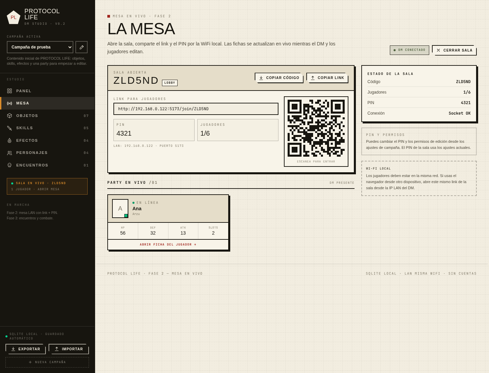
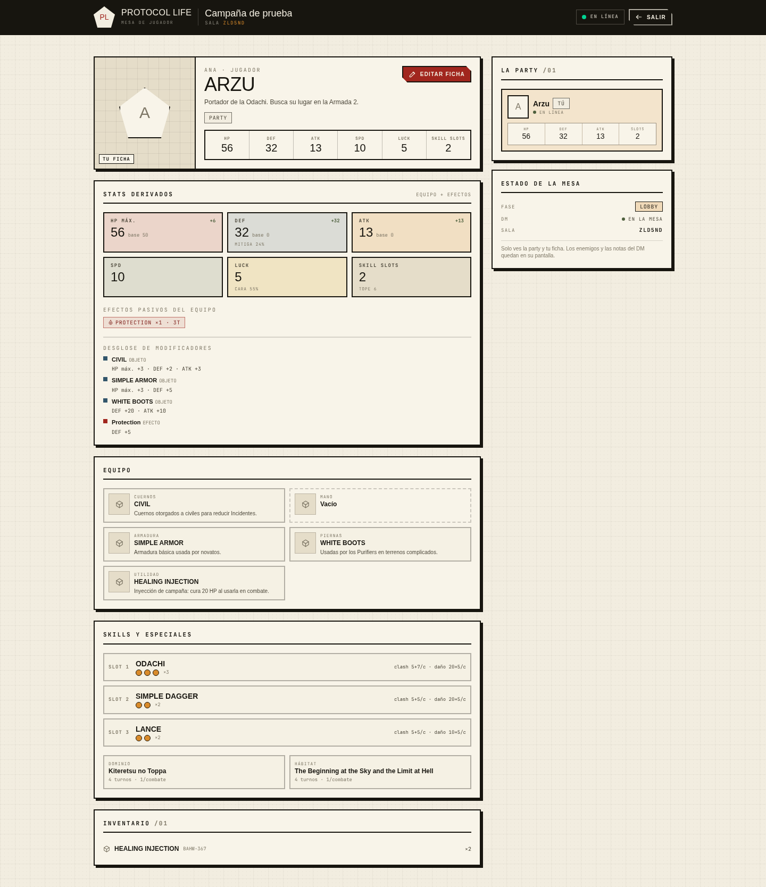
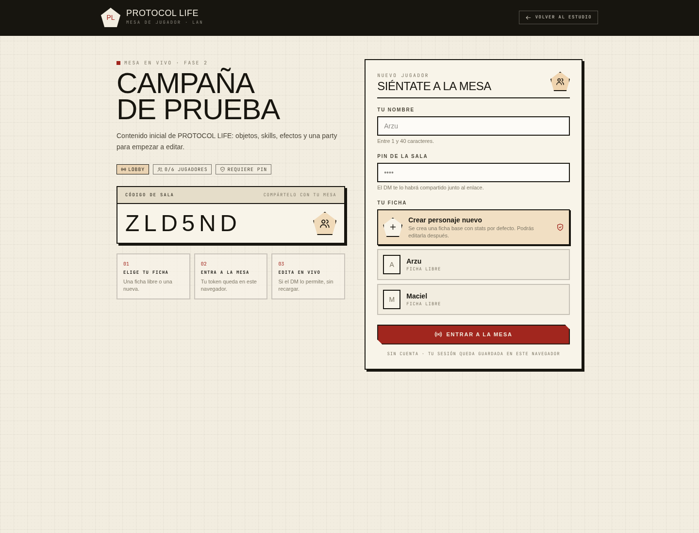
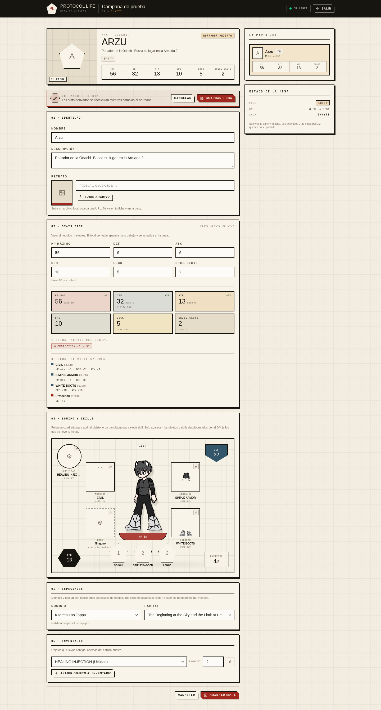
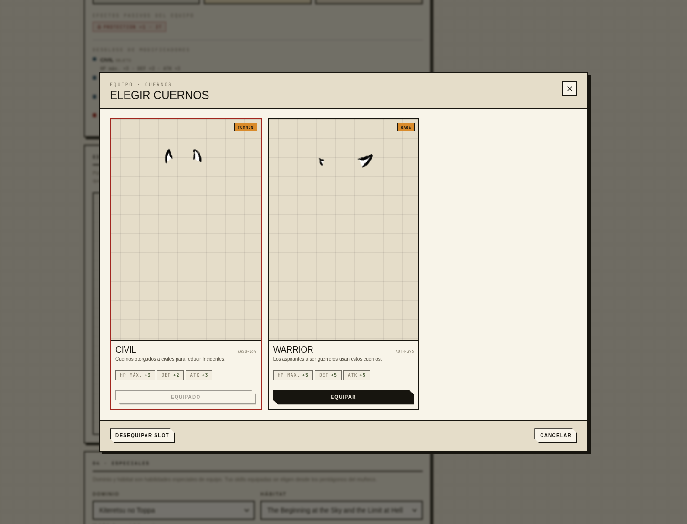
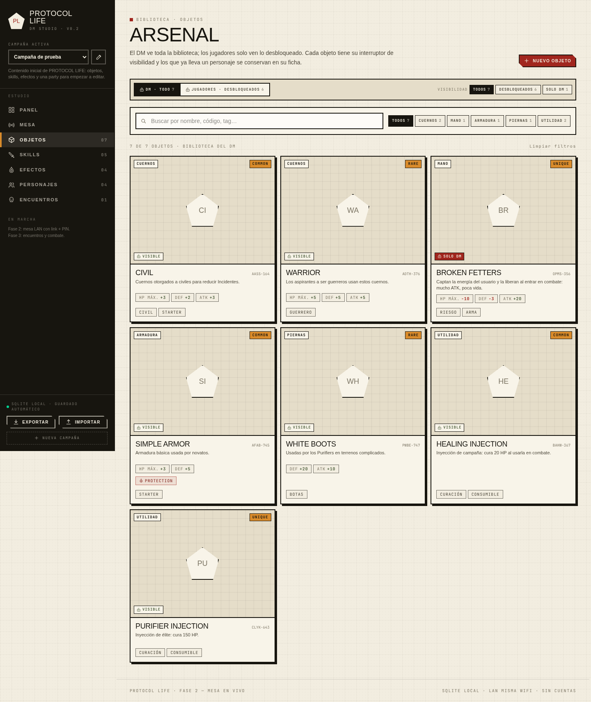
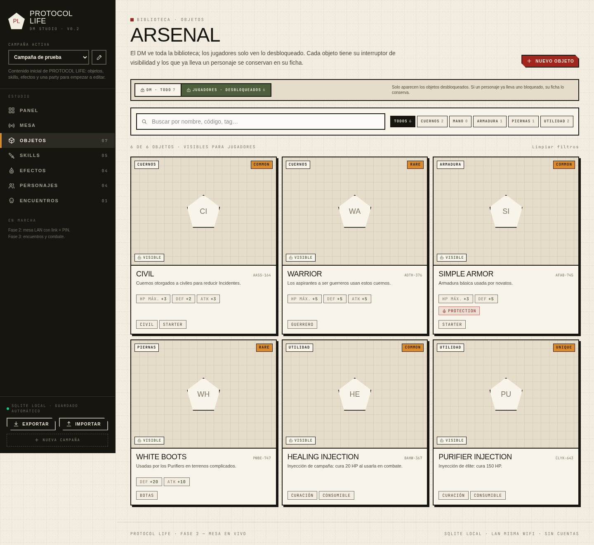
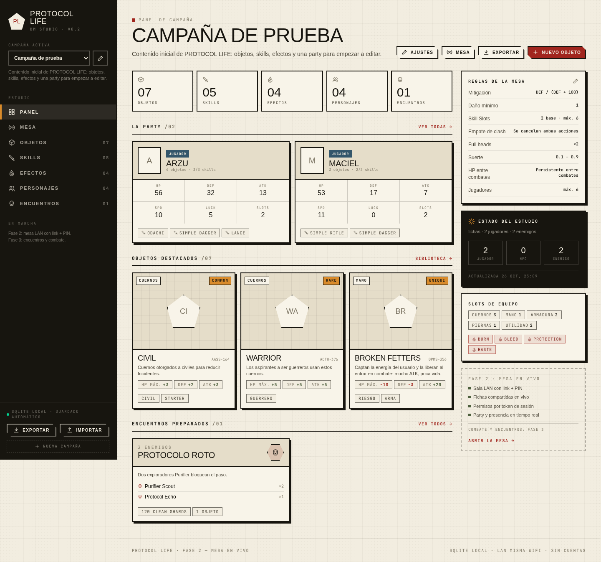
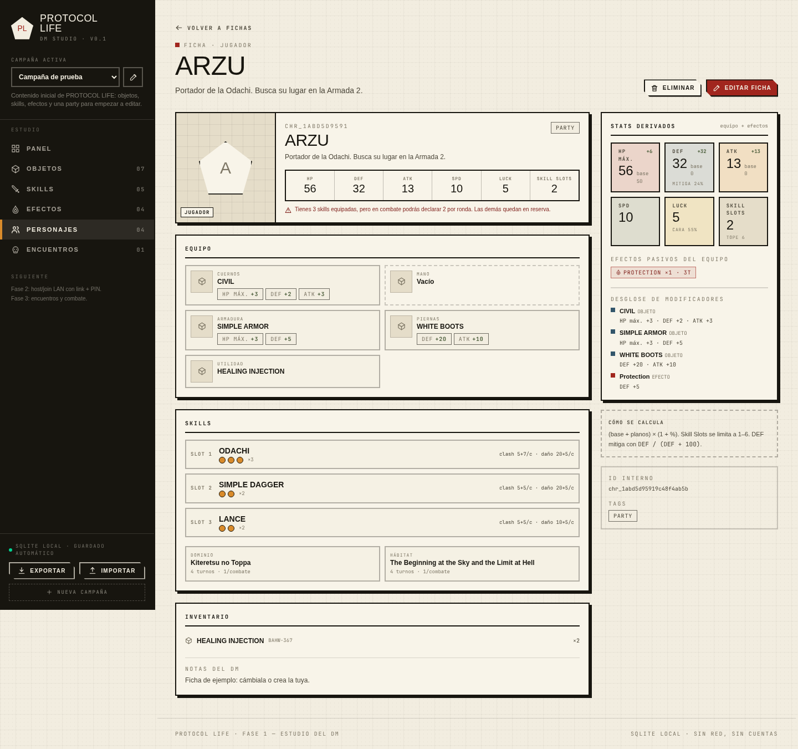

# PROTOCOL LIFE

Aplicación para que un **DM** cree y dirija su campaña de rol con contenido personalizado, y para que su mesa se conecte desde el navegador por la WiFi local. El combate está inspirado en *Limbus Company*: skills con monedas, clash, DEF y status effects.

> **Estado actual: Fase 4 completada** — estudio del DM, mesa LAN, combate por rondas, economía de Clean Shards con tiendas, mazmorras lineales con escenas y backup/restore del SQLite. La Fase 5 (crawler 2D con tilemap) queda como futuro.



## Arranque rápido

Requisitos: **Node >= 22** (probado con Node 26.10.0) y **npm >= 10** (probado con 11.19.1). No hace falta pnpm.

```bash
cd protocol-life
npm install
npm run dev
```

- Estudio del DM: <http://localhost:5173>
- API (Fastify): <http://localhost:3001/api/health>
- En la terminal, Vite muestra la **IP LAN** (por ejemplo `http://192.168.0.122:5173`).

En el primer arranque se crea automáticamente la campaña **Campaña de prueba** con 7 objetos, 5 skills, 4 efectos, 4 personajes y 1 encuentro. Todo es editable.

Los datos viven en `data/protocol-life.sqlite` (ignorado por git). Las imágenes subidas van a `data/uploads/`.

### Jugar en LAN

1. El DM abre **Mesa → Abrir sala**. Puede activar un PIN; el servidor genera un código de 6 caracteres.
2. La pantalla de mesa muestra el **link LAN**, el **QR** y el **PIN**.
3. Los jugadores (misma WiFi) abren el link desde el móvil u otro PC.
4. Eligen nombre, PIN y ficha libre (o crean una nueva).
5. Ya están dentro: ven su ficha, la party y editan su personaje si el DM lo permite.

Si el link no abre, revisa el firewall del equipo del DM y desactiva el *aislamiento de clientes* del router. En desarrollo la web escucha en `0.0.0.0:5173` y la API en `0.0.0.0:3001`; en producción `npm run build && npm start` sirve ambos en el puerto de la API.

### Jugar en Windows (portátil del DM)

Recomendado: **Windows nativo** y el build de producción. No copies `node_modules`
desde Linux: `better-sqlite3` lleva un binario nativo distinto y hay que instalarlo
en Windows. WSL2 también funciona, pero su red LAN necesita configuración extra;
para la mesa es más simple Windows nativo.

1. Instala **Node.js 22 LTS** (o 24 LTS) desde <https://nodejs.org> o con
   `winget install OpenJS.NodeJS.LTS`. Comprueba `node -v` y `npm -v`.
2. Copia el proyecto a una carpeta local, por ejemplo `C:\ProtocolLife`.
   Evita `Program Files` y, si puedes, una carpeta sincronizada con OneDrive
   (SQLite + WAL no se llevan bien con la sincronización).
3. En PowerShell:

   ```powershell
   cd C:\ProtocolLife
   npm install
   npm run build
   npm start
   ```

4. Abre <http://localhost:3001>. `npm start` sirve la web, la API y Socket.IO en
   el mismo puerto. Para tu campaña usa este modo; `npm run dev` (3001 + 5173)
   es solo para desarrollar.

Si `npm install` falla al compilar `better-sqlite3`, instala **Visual Studio
Build Tools** con la carga «Desktop development with C++» y **Python 3**, y
vuelve a ejecutar `npm install` (o `npm rebuild better-sqlite3`). Usar Node 22
LTS reduce mucho la probabilidad de ese problema.

#### Pasar la campaña de Linux a Windows

La base de datos es `data/protocol-life.sqlite` y las imágenes subidas están en
`data/uploads/` (no van dentro del SQLite).

1. En Linux, con el servidor parado o en marcha (el backup es seguro):
   `npm run backup`.
2. Copia el archivo más reciente de `data/backups/protocol-life-....sqlite` y la
   carpeta `data/uploads/` al portátil.
3. En Windows, con el servidor **parado**, tras `npm install`:

   ```powershell
   npm run restore -- "C:\ruta\al\protocol-life-2026....sqlite"
   ```

   Restaura en `data/protocol-life.sqlite`, valida la copia y guarda antes una
   copia `pre-restore-*`.
4. Copia `uploads` a `C:\ProtocolLife\data\uploads\` y arranca con
   `npm run build` + `npm start`.

Alternativa: exportar la campaña como JSON desde la UI e importarla en Windows.
Es cómodo, pero no conserva sesiones/combates activos y las imágenes subidas
siguen necesitando copiar `data/uploads/`. Para conservarlo todo, usa
backup/restore (ver [Backup y restore](#backup-y-restore)).

#### LAN y firewall en Windows

- Todos en la misma WiFi. La primera vez, Defender preguntará por Node.js:
  permite **Redes privadas**. Si no, añade una regla de entrada TCP **3001**.
- Obtén la IPv4 con `ipconfig` y comparte `http://192.168.x.x:3001` (no
  `localhost`, que solo funciona en el portátil del DM).
- Si los móviles no conectan, desactiva el *aislamiento de clientes/AP isolation*
  del router y evita que el portátil se suspenda.
- El PIN es una barrera de conveniencia: no expongas el puerto a internet.

#### Arranque con doble clic

Puedes crear `start.bat` en la raíz del proyecto:

```bat
@echo off
cd /d "%~dp0"
npm start
pause
```

`npm start` no recompila la web: ejecuta `npm run build` después de actualizar
el código. Los backups diarios siguen viviendo en `data/backups/`; el restore
exige el servidor parado, igual que en Linux.

## Scripts

| Comando | Qué hace |
|---|---|
| `npm run dev` | Levanta servidor (3001) y web (5173), con LAN habilitada y recarga en caliente. |
| `npm run dev:server` / `npm run dev:web` | Solo uno de los dos. |
| `npm test` | Vitest: stats, validación, API, sesiones/permisos, Socket.IO e import/export. |
| `npm run typecheck` | TypeScript estricto en los tres workspaces. |
| `npm run build` | Build de producción de la web (`apps/web/dist`). |
| `npm start` | Arranca el servidor; si existe `apps/web/dist`, también sirve la web y el socket. |
| `npm run seed` | Garantiza que exista la campaña inicial (no borra ni duplica). |
| `npm run backup` | Copia manual del SQLite en `data/backups/` (segura con el servidor abierto). |
| `npm run restore -- <archivo>` | Restaura una copia; exige el servidor parado y guarda antes la base actual. |

## Qué incluye

### Fase 1 — Estudio del DM

- Monorepo npm workspaces con `apps/web`, `apps/server` y `packages/shared`.
- Tipos del contrato v0.1, esquemas Zod, motor puro de stats derivados y validación de referencias.
- Fastify + SQLite + Drizzle, CRUD de campañas, objetos, skills, efectos, personajes y encuentros.
- Subida local de imágenes, export/import JSON con remapeo de IDs y seed editable.
- Web con dashboard, bibliotecas, editores, ficha con equipo y stats en vivo, ajustes de reglas.
- UI en español, estética de papel + bordes negros + formas geométricas, responsive.

### Fase 2 — Mesa en vivo

- **Host/join LAN** con código de 6 caracteres, link construido con la IP LAN, QR y PIN opcional.
- **Sesiones con tokens**: `dmToken` y un `playerToken` por jugador, persistidos en SQLite y en `localStorage`.
- **Fichas compartidas**: el DM y los jugadores editan; los cambios se empujan por Socket.IO sin recargar.
- **Party y presencia** en vivo: quién está en línea, su ficha y sus stats derivados.
- **Permisos de servidor**: el jugador solo edita su propia ficha; no puede tocar contenido, campaña, export ni otras fichas. En combate no se edita (preparado para Fase 3).
- **Estado del jugador saneado**: sin enemigos, sin notas del DM, sin PIN y sin encuentros.
- **Biblioteca por desbloqueo**: el DM ve todos los objetos/skills y decide con un interruptor cuáles aparecen a los jugadores. Hay vistas “DM · todo” y “Jugadores · desbloqueados”.
- **Muñeco de equipo del jugador**: slots alrededor de la imagen base, overlay de objetos con imagen y stats, y capas de equipo sobre el personaje. Las skills se eligen desde sus pentágonos.
- **Imagen base configurable**: el DM la elige en la campaña nueva o en los ajustes; el seed trae una base 200×300 y arte local para varios objetos.
- **Reconexión**: recargar la pestaña recupera la sesión guardada; cerrar la sala libera las fichas.
- **Recuperación del DM**: abrir una sala nueva reemplaza la anterior y permite fijar el PIN desde la propia mesa.

### Fase 3 — Encuentros y combate

- **Encuentros** con enemigos, recuento y overrides, dos capas de escena (piso y
  pared) y tema `paper`/`night`; el DM puede cambiar la escena en vivo.
- **Motor puro y determinista**: SPD base + tirada 1..4 con la seed del combate,
  iniciativa, clash por unidad (sin importar slot), monedas, DEF/(DEF+100),
  efectos, utilidad, dominio/hábitat, redirección y HP persistente.
- **Side-view** con party a la derecha y enemigos a la izquierda, sprites en
  capas o `portrait`, SkillSlots pentagonales, líneas de intención
  (azul/amarillo/rojo/verde) y `targetSlot` visual.
- **Declaración abierta**: el DM controla a los enemigos y cada jugador su
  unidad. El servidor resuelve cuando todas las unidades vivas están bloqueadas.
- **Cinemática de clash** desde los eventos ya resueltos: monedas girando,
  totales, perdedor tachado y daño. Nunca bloquea la lógica.
- **HP enemigo** en porcentaje para jugadores; exacto para el DM y la party. En
  combate nadie edita fichas ni HP: el DM solo controla enemigos.
- **Presencia**: los jugadores desconectados no entran al iniciar el combate; si
  se desconectan a mitad, su unidad se auto-bloquea para que la ronda avance y
  se conserva para la reconexión.

#### Cómo jugar un encuentro

1. El DM crea los enemigos en **Personajes** y arma el grupo en **Encuentros**
   (enemigos, capas de piso/pared y tema de escena).
2. En **Mesa**, abre la sala y comparte el link/QR/PIN. Los jugadores entran,
   eligen ficha y aparecen en la party.
3. El DM inicia el encuentro desde la mesa. La escena muestra la party a la
   derecha y los enemigos a la izquierda.
4. Cada jugador hace click en un SkillSlot de su personaje, elige la skill y
   luego el objetivo; la línea muestra la intención y el slot visual elegido.
   Después pulsa **Listo**.
5. El DM declara las acciones de los enemigos y pulsa **Listo (todos)**.
6. Cuando todas las unidades vivas están bloqueadas, el servidor resuelve la
   ronda: monedas, clash, daño, efectos y cinemática. La cinemática dura 4,8 s
   por clash y una barra de progreso indica cuándo pasa al siguiente (o al
   terminar). No hay cálculos en el cliente.
7. Se repiten las rondas hasta la victoria o la derrota. Al terminar, el HP de
   la party se guarda; fuera de combate, **Rest party** cura a la party.

### Fase 4 — Economía, mazmorras y operación

- **Clean Shards** como bolsa común de la party, persistida en
  `campaigns.extras.wallet`. Las recompensas de encuentro pagan moneda una vez y
  entregan los objetos a cada jugador; con `shareLoot` desactivado y 2+
  jugadores se reparte por turnos en orden serpiente.
- **Tiendas en vivo**: el DM elige objetos y skills, precio y stock; abre la
  tienda en la mesa y la sala ve una escena a pantalla completa. Comprar paga la
  bolsa y **desbloquea para la campaña** el objeto o la skill; no los mete en el
  inventario ni equipa la skill. Stock vacío = infinito, `0` = agotado.
- **Mazmorras lineales+**: salas ordenadas con tipo (`encounter`, `boss`, `rest`,
  `treasure`), escena propia (imagen/GIF/URL de vídeo), texto público y notas
  privadas del DM. La entrada se elige en el editor. El DM inicia la run, lanza
  el encuentro, descansa, abre cofres, avanza y termina; los jugadores ven la
  escena y la ruta sin notas.
- **Cofres**: la moneda va a la bolsa; los objetos se entregan (o van a un loot
  draft) y las skills se desbloquean para la campaña. Con
  **Desbloquear para la campaña** activo, los objetos también quedan
  desbloqueados para todos, no solo en el inventario del que los recibe.
- **Backup/restore**: copia diaria y manual del SQLite, retención configurable,
  restore por CLI con el servidor parado, validación de integridad y copia previa
  de la base actual.
- **Permisos**: solo el DM abre tiendas y dirige mazmorras; solo los jugadores
  compran. Tienda y mazmorra no conviven en la mesa; un combate normal cierra la
  run y la victoria en una sala de encuentro la marca como superada.

#### Cómo jugar una mazmorra

1. Crea las salas en **Mazmorras**: orden, tipo, escena, notas privadas y, en los
   tesoros, su recompensa (objetos, skills, moneda y modo de desbloqueo).
2. Abre la sala en **Mesa** y comparte el link. En el panel **Mazmorra en la
   mesa**, elige la mazmorra y la sala de entrada y pulsa **Iniciar mazmorra**.
3. La escena sustituye la hoja del jugador. Si la sala es de encuentro, pulsa
   **Iniciar encuentro**; se juega como un combate normal. Al ganar, la sala
   queda superada y la escena de la mazmorra vuelve al cerrar el resultado.
4. En una sala de descanso, **Descansar** cura a la party una vez. En un tesoro,
   **Abrir cofre** entrega la recompensa una sola vez.
5. **Avanzar de sala** solo está disponible cuando la sala actual está resuelta
   o no tiene acción (ambientación). En la última sala, avanzar termina la run.
6. **Terminar mazmorra** cierra la run y devuelve a todos a su hoja. La tienda se
   cierra al iniciar la mazmorra y abrir una tienda cierra la run.

#### Dados de mesa

En la hoja del jugador, debajo de la bolsa de la party, hay una bandeja con los
dados **d20, d12, d100, d10, d8, d6 y d4**. Se elige uno en la fila inferior,
se ajusta la cantidad con **+ / −** (hasta 20 dados del mismo tipo) y se pulsa
el dado grande para tirar. También se puede **arrastrar el dado grande** en la
dirección del lanzamiento: la distancia marca la fuerza y los **rebotes** contra
la mesa (1 con un gesto suave, 4 con el máximo). El servidor simula la caída con
física real para **todos los dados** y añade su propia entropía; en d4 el
resultado es el **vértice superior**, en el resto la cara que queda arriba y en
**d100** se lanzan **dos d10** (decenas 00-90 + unidades 0-9; 00+0 = 100). Toda
la mesa conectada recibe un pop de 5 segundos con el dado, el resultado y quién
lo tiró; las últimas 5 tiradas quedan en un log efímero del cliente. El DM tiene
la misma bandeja en el panel lateral de **Mesa**.

La lista **Aspecto** cambia la skin del dado 3D y de la bandeja. Hay seis:
**Hueso** (clara), **Negra** (cuerpo oscuro con números marfil), **Ámbar**
(resina cálida), **Jade** (verde profundo con números menta), **Carmesí**
(vino con números crema y acentos cobre) y **Volcánica** (basalto oscuro con
grietas de lava incandescente). Se guarda en el navegador y se aplica también al
primer plano del resultado y a las etiquetas de multi-dado. Las grietas de la
volcánica son procedurales y usan el atlas como mapa emisivo, así que brillan
sin necesidad de animación.

El botón de **altavoz** de la cabecera de dados activa o silencia los sonidos.
Son sintetizados con Web Audio (sin ficheros): un roce al lanzar y un chasquido
por cada rebote, con tono según el dado y paneo según el punto de la mesa. El
estado se guarda en el navegador. Un **Nat 20** añade un arpegio de campana
ascendente y un **Nat 1** un golpe grave con retumbe, por encima de los impactos.
El audio se desbloquea con el primer clic o arrastre, como exige el navegador;
si se silencia, no se programa ningún sonido.

Los **dados múltiples** se lanzan en la misma mesa: caen juntos, colisionan
entre ellos y cada uno trae su propia trayectoria y su resultado. La cámara se
abre a una vista de grupo, cada dado muestra su número en una etiqueta y el pop
resume la suma y el desglose. Los topes físicos son 12 para d4/d6/d8/d20, 10
para d10, 7 para d12 y 6 para d100; por encima de cada tope se usa el pop
clásico. En d100 la etiqueta flotante muestra el número combinado de cada pareja
de d10.

Si en un **d20** sale una cara **20**, la pantalla se llena de brillitos dorados
y aparece «¡NAT 20!»; si sale una cara **1**, los bordes se tiñen de rojo y la
página hace un pequeño rumble. El 20 tiene prioridad si en una tirada múltiple
salen 20 y 1. Solo se celebra la **cara individual** (un 10+10 en 2d20 no es Nat
20), dura ~2 s, no bloquea clics y respeta `prefers-reduced-motion`. Es flavor
de mesa: no cambia reglas, combate, dados ni se guarda en SQLite.

### Capturas

| Mesa del jugador | Entrada a la sala |
|---|---|
|  |  |

| Muñeco de equipo | Overlay de objetos |
|---|---|
|  |  |

| Biblioteca del DM | Biblioteca de jugadores |
|---|---|
|  |  |

| Panel del DM | Ficha con stats derivados |
|---|---|
|  |  |

## Estructura

```text
protocol-life/
  apps/
    web/                 # React + Vite + Tailwind + Zustand
      src/
        components/      # layout, UI, tarjetas, muñeco de equipo, editor del jugador
        pages/           # estudio del DM + JoinPage/PlayerTablePage
        store/           # useAppStore (DM), useLiveStore (mesa DM), usePlayerStore
        lib/             # api, sessionAuth, helpers
      public/assets/     # imagen base y arte local del seed
    server/              # Fastify + SQLite + Drizzle + Socket.IO
      src/
        app.ts           # buildApp (rutas, realtime, estáticos, errores)
        db.ts            # SQLite + DDL idempotente (incluye sessions)
        schema.ts        # tablas Drizzle
        repository.ts    # CRUD, validación, export/import
        sessions.ts      # salas, tokens, presencia, saneado
        realtime.ts      # Socket.IO
        routes.ts        # API HTTP + auth de sesión + uploads
        network.ts       # detección de IPs LAN
        seed.ts          # contenido inicial
  packages/
    shared/              # tipos, Zod, stats, validación, contrato de sesión
  docs/                  # diseño, contrato, notas y capturas
  data/                  # SQLite/uploads/backups (git-ignored)
```

## Stack

- **Web:** React 19, TypeScript, Vite 8, Tailwind CSS 4, Zustand 5, React Router 7, Socket.IO Client, `qrcode.react`.
- **Servidor:** Node, Fastify 5, Socket.IO 4, SQLite (`better-sqlite3`) y Drizzle ORM.
- **Compartido:** Zod 4 + motor puro de stats y validación.
- **Tests:** Vitest 5 + `socket.io-client` en integración.
- **Monorepo:** npm workspaces (Node 26, npm 11).

### Notas de implementación

- **SQLite:** `better-sqlite3@13` funciona en Node 26. WAL, FKs y DDL idempotente; no hace falta `drizzle-kit` en esta fase.
- **Sesiones en SQLite:** una sala activa por campaña. Los tokens son secretos y nunca salen en las vistas públicas. La presencia se resetea al arrancar el servidor y se reconstruye al reconectar.
- **Mutaciones por HTTP, eventos por Socket.IO:** el servidor valida permisos y después emite `campaign:refresh`/`session:players`; el cliente nunca muta por socket.
- **PIN:** usa los ajustes de la campaña y se puede fijar al abrir la sala. Es una barrera de conveniencia en LAN, **no autenticación fuerte**.
- **Tokens:** el DM y cada jugador reciben un token aleatorio. Se guardan en `localStorage` con claves separadas por rol; cada pestaña tiene su propio contexto en memoria.
- **Desbloqueo:** `unlocked?: boolean` en `Item` y `Skill`. Ausente o `false` = solo DM. Los jugadores solo pueden elegir contenido desbloqueado; el servidor rechaza con `403 content_locked`. Lo que ya lleva un personaje se conserva en su ficha aunque el DM lo vuelva a bloquear.
- **Contenido JSON validado:** las entidades completas viven en columnas JSON validadas con Zod; las tiendas/mazmorras del modelo se guardan en `campaigns.extras`.
- **Base visual:** `campaign.settings.baseCharacterImage` (default `/assets/base-character.png`). Las imágenes de objeto se usan a la vez como arte del slot y como capa sobre la base; el seed trae capas locales 200×300 para CIVIL, WARRIOR, SIMPLE ARMOR, WHITE BOOTS y BROKEN FETTERS. El arte de ejemplo viene del prototipo original y se puede reemplazar subiendo imágenes.
- **Stats derivados:** `(base + planos) × (1 + porcentajes)`, Skill Slots limitados a `1..rules.maxSkillSlots`.
- **Moneda:** **Clean Shards**. Nunca dinero real.

## Modelo y decisiones

El diseño v0.1 está cerrado en [`docs/DISENO-v0.1.md`](./docs/DISENO-v0.1.md) y el contrato en [`docs/schema-v0.1.ts`](./docs/schema-v0.1.ts).

- 1 DM + hasta 6 jugadores por sala, LAN con link/QR + PIN.
- 2 Skill Slots base, máximo 6; dominios/hábitats cuestan 1 slot y son 1 vez por combate.
- DEF porcentual: `DEF / (DEF + 100)`, daño mínimo 1.
- Empate de clash: se cancelan ambas acciones.
- HP persistente entre combates; el DM descansa al equipo fuera de combate.
- Imágenes: upload local + URL opcional.
- En combate nadie edita fichas; el DM solo controla enemigos.
- Side-view híbrido decidido para Fase 3: party por capas, enemigos con sprite único, fallback a retrato.
- Sin cuentas, sin IA automática, sin app móvil nativa.

## API

Todas las respuestas de error usan `{ "error": { "code", "message", "issues?" } }`. Cuando hay una sala abierta, las mutaciones requieren `x-session-token` (o `Authorization: Bearer`); si no hay sala, se mantiene el modo local de Fase 1.

| Método | Ruta | Descripción |
|---|---|---|
| GET | `/api/health` | Estado del servidor. |
| GET | `/api/network` | IPs LAN detectadas para el link. |
| GET/POST | `/api/campaigns` | Listar / crear campaña. |
| GET/PATCH/DELETE | `/api/campaigns/:id` | Obtener / editar / borrar campaña. |
| POST | `/api/campaigns/:id/session` | Abrir (o reemplazar) la sala; acepta `requirePin`/`pin`. |
| GET | `/api/sessions/:code` | Info pública de la sala (sin tokens). |
| GET | `/api/sessions/:code/state` | Estado para DM o jugador según token; el jugador recibe campaña saneada. |
| POST | `/api/sessions/:code/join` | Unirse con nombre, PIN y ficha opcional. |
| POST | `/api/sessions/:code/leave` | Salir y liberar la ficha. |
| POST | `/api/sessions/:code/close` | Cerrar la sala (solo DM). |
| GET | `/api/campaigns/:id/export` | Exportar campaña (solo DM si hay sala). |
| POST | `/api/campaigns/import` | Importar JSON y remapear referencias. |
| GET/POST | `/api/campaigns/:id/shops` | Listar / crear tiendas (objetos y skills a la venta). |
| PATCH/DELETE | `/api/campaigns/:id/shops/:shopId` | Editar / borrar tienda. |
| POST | `/api/campaigns/:id/wallet` | Ajustar la bolsa común (delta, nunca negativa). |
| GET/POST | `/api/campaigns/:id/dungeons` | Listar / crear mazmorras (DM si hay sala). |
| PATCH/DELETE | `/api/campaigns/:id/dungeons/:dungeonId` | Editar / borrar mazmorra. |
| GET | `/api/sessions/:code/shop` | Escena de tienda abierta (o `null`). |
| POST | `/api/sessions/:code/shop/open\|close` | Abrir / cerrar la tienda en la mesa (DM). |
| POST | `/api/sessions/:code/shop/buy` | Comprar `{ itemId }` o `{ skillId }`; desbloquea para la campaña. |
| GET | `/api/sessions/:code/dungeon` | Run de mazmorra activa saneada (o `null`). |
| POST | `/api/sessions/:code/dungeon/start\|encounter\|rest\|chest\|advance\|end` | Acciones del DM sobre la run. |
| POST | `/api/sessions/:code/dice` | Tirada compartida `{ sides, count?, throw? }` (1–20 dados, se suman); `throw` lleva velocidad/angular/salida/rebotes (1–4) para la física. El servidor decide el resultado y lo emite a la sala; d100 devuelve dos trayectorias de d10 por dado. |
| GET/POST | `/api/campaigns/:id/:type` | Listar / crear contenido (`items`, `skills`, `effects`, `characters`, `encounters`). |
| GET/PATCH/DELETE | `/api/content/:type/:id` | Leer / editar / borrar; el jugador solo puede editar su ficha. |
| GET | `/api/campaigns/:id/characters/:charId/sheet` | Ficha con equipo y stats derivados. |
| POST | `/api/uploads` | Subir imagen (multipart `file`, máx. 5 MB). |
| GET | `/uploads/:file` | Servir imagen subida. |

**Socket.IO** (mismo origen, path `/socket.io`; auth `{ code, token }`):

- Servidor → cliente: `session:state`, `session:players`, `campaign:refresh`, `session:closed`, `session:error`, `combat:*`, `loot:updated`, `shop:state`, `dungeon:state`, `dice:rolled`.
- `state:full` incluye el combate vivo, `lootDraft`, `activeShop` y `dungeonRun` para reconexiones.
- El cliente no muta por socket: las escrituras van por HTTP y se validan en el servidor.

### Permisos

- **DM:** todo el contenido, campaña, fichas y cierre de sala.
- **Jugador:** solo su propia ficha, si `allowPlayerEdit` y fuera de combate. No puede cambiar `kind`/`ownerId` ni borrar contenido.
- Los GET de contenido son locales/LAN; la vista del jugador usa el estado saneado. La seguridad asume una WiFi de confianza y **no está pensada para exponer el servidor a internet**.

## Import / export

- Export: JSON con `schemaVersion: 1`, reglas, settings, bolsa, contenido, tiendas y mazmorras.
- Import: valida con Zod, comprueba referencias, genera IDs nuevos para campaña y contenido, y remapea equipo, skills, efectos, inventarios, encuentros, recompensas, tiendas (incluidas sus skills), mazmorras, salas y recompensas de cofre. Se puede importar el mismo archivo varias veces sin colisiones.

## Backup y restore

- **Copia automática diaria:** al arrancar el servidor y cada 6 horas se comprueba si ya hay una copia del día; si no, se crea en `data/backups/` con nombre `protocol-life-YYYYMMDD-HHmmss.sqlite`. No bloquea la mesa ni el arranque.
- **Copia manual:** `npm run backup`. Usa `Database#backup` de SQLite, así que produce un snapshot consistente **aunque el servidor esté en marcha** y con WAL activo. Se puede cambiar la retención con `PROTOCOL_BACKUP_RETENTION` (default 7) o `npm run backup -- --keep 14`.
- **Restauración:** `npm run restore -- data/backups/protocol-life-....sqlite`. Antes comprueba que el servidor esté parado (lock con PID), valida el archivo (`integrity_check` y tabla `campaigns`), guarda una copia `pre-restore-*.sqlite` de la base actual y sustituye el SQLite. Si el archivo no existe o no es válido, la base actual no se toca. **No hay endpoint HTTP de restore.**
- **Imágenes:** el backup es solo del SQLite. `data/uploads/` (imágenes subidas) hay que copiarlo aparte para no perderlas.
- **Si el servidor se cae:** puede quedar un lock obsoleto en `data/protocol-life.sqlite.lock`; el siguiente arranque o el restore lo detectan por PID y lo retiran solos.
- Flujo recomendado: `npm run backup` antes de una sesión importante; para restaurar, parar el servidor (`Ctrl+C`), ejecutar `npm run restore -- <copia>` y volver a arrancar.

## Variables de entorno

| Variable | Default | Uso |
|---|---|---|
| `PORT` | `3001` | Puerto del servidor. |
| `HOST` | `0.0.0.0` | Interfaz de escucha; LAN habilitada. Usa `127.0.0.1` para aislar. |
| `PROTOCOL_DATA_DIR` | `./data` | Carpeta de datos. |
| `PROTOCOL_DB` | `./data/protocol-life.sqlite` | Ruta del SQLite. |
| `PROTOCOL_UPLOADS_DIR` | `./data/uploads` | Carpeta de imágenes. |
| `PROTOCOL_WEB_DIST` | `./apps/web/dist` | Build web que sirve el servidor (si existe). |
| `PROTOCOL_BACKUPS_DIR` | `./data/backups` | Carpeta de copias de seguridad. |
| `PROTOCOL_BACKUP_RETENTION` | `7` | Copias diarias que se conservan (mínimo 1). |
| `PROTOCOL_API_URL` | `http://127.0.0.1:3001` | Destino del proxy de Vite (API + Socket.IO). |
| `VITE_API_URL` | vacío (same-origin) | API base del cliente si se sirve por separado. |

## Tests

```bash
npm test
```

- `packages/shared`: stats derivados, porcentajes, stacks, límites, referencias, schemas Zod y campaña; side-view (`visual.test.ts`) y motor de combate (`combat/engine.test.ts`).
- `apps/server/src/api.test.ts`: CRUD, ficha derivada, persistencia, export/import.
- `apps/server/src/sessions.test.ts`: host/join, PIN, tokens, permisos, saneado, límite de jugadores, salida/cierre y liberación de fichas.
- `apps/server/src/realtime.test.ts`: dos clientes Socket.IO reales, presencia, refresco al editar y cierre de sala.
- `apps/server/src/combat.test.ts`: snapshot, escena, presencia/auto-lock, HP persistente, Rest party, export/import visual y bloqueo de edición en combate.
- `apps/server/src/combat-round.test.ts`: declaraciones, slots, redirección, efectos, determinismo con seed y resolución de rondas.
- `apps/server/src/combat-socket.test.ts`: consola DM/jugador por Socket.IO, permisos, reconexión y fin de combate.
- `apps/server/src/economy.test.ts`: bolsa, CRUD/validación de tiendas, export/import, saneado y recompensas.
- `apps/server/src/shop-scene.test.ts`: abrir/cerrar tienda, compra de objetos y skills, stock, fondos, desbloqueo y permisos.
- `apps/server/src/loot.test.ts` y `packages/shared/src/loot.test.ts`: reparto por turnos, serpiente, entrega y cierre.
- `apps/server/src/dungeon.test.ts`: CRUD/validación de mazmorras, recompensas de cofre y export/import con remapeo.
- `apps/server/src/dungeon-run.test.ts`: run, combate/victoria/derrota, descanso, cofre, skills, avance, fin, permisos y exclusividad con tienda.
- `apps/server/src/backup.test.ts`: copia con el servidor abierto, retención, copia diaria, restore en base temporal, copia previa de seguridad, archivo inválido/ausente y lock del servidor.
- `apps/server/src/dice.test.ts`: tirada en servidor, tirada múltiple con suma, permisos, cooldown, resultados en rango y broadcast `dice:rolled`.
- `apps/web/src/lib/dice.test.ts`: detección de Nat 20/Nat 1 por cara individual, prioridad del 20 y no confundir con la suma.
- `apps/server/src/fase4-qa.test.ts`: sesión completa de Fase 4 con 2 jugadores (tienda, mazmorra, combate, cofre, skills, backup/restore y reconexión).
- `apps/web/src/lib/combat.test.ts` y `clash.test.ts`: contrato de `targetSlot` y lectura de la cinemática de clash.

## Roadmap

- **Fase 1 — Estudio del DM:** completada.
- **Fase 2 — Mesa en vivo:** completada.
- **Fase 3 — Encuentros y combate:** completada (`CombatState`, declaraciones, clash, monedas, DEF, efectos, utilidad, log animado, consola del DM y side-view híbrido).
- **Fase 4 — Contenido avanzado:** completada (economía con Clean Shards, tiendas con objetos y skills, mazmorras lineales con escenas, reparto de botín, backup/restore y QA de sesión completa).
- **Fase 5 — Crawler 2D:** futuro (tilemap, movimiento, niebla y editor de mapas); no incluido en v0.1.

## Documentos

- [Diseño v0.1](./docs/DISENO-v0.1.md)
- [Contrato de datos v0.1](./docs/schema-v0.1.ts)
- [Notas de implementación de Fase 1](./docs/FASE-1.md)
- [Notas de implementación de Fase 2](./docs/FASE-2.md)
- [Rediseño de combate y cierre de 3F.5](./docs/REDISENO-COMBATE.md)
- [Mapa de migración al tema oscuro](./docs/UI-MIGRATION-MAP.md)
- [Changelog de Fase 3](./CHANGELOG.md)
- [Prompts de Fase 4](./docs/PROMPTS-FASE-4.md)
- [Decisión de side-view (Fase 3)](./docs/DECISION-SIDE-VIEW.md)
- [Handoff / plan de Fase 1](./docs/HANDOFF-FASE-1.md)
- [Prototipo original](./reference/protocol-game-v1.1.html) (solo referencia estética/mecánica)
